  

<!-- Hero (dark/light aware) -->
<picture>
  <source media="(prefers-color-scheme: dark)" srcset="https://capsule-render.vercel.app/api?type=waving&height=220&color=0:0ea5e9,100:22d3ee&text=MAKASA%20Laboratory%20%C3%97%20Full%20Stack%20Masters&desc=Modern%2C%20Adaptive%20Knowledge%20in%20Agriculture%2C%20Science%2C%20and%20Applications&fontColor=ffffff&fontAlignY=35&descAlignY=60&animation=fadeIn" />
</picture>

  

<strong>ᜉᜈᜈᜎᜒᜃ᜔ᜐᜒᜃᜈ᜔ ᜅ᜔ ᜋᜃᜐ x Full Stack Masters</strong>

in collaboration with

  

<strong>Computing Society — Bohol Island State University, Bilar Campus</strong>

<em>Research · Development · Student Innovation</em>

  
  
  
  
  
  
  
  
  

  

## ⚠️ Ownership & IP Notice (Read First)
> All **code, content, datasets, and documentation** produced as part of **University work**—including **classwork, assignments, projects, capstone, theses**, and any output created **using University time or resources** (e.g., lab hours, equipment, software licenses, servers)—are the **property of the University**.  
> Contributors are **credited as authors** but **do not own** the IP **unless a written agreement approved by the University explicitly states otherwise**.  
> By contributing to this organization, you agree to:
> - Keep **official source code** in the **MAKASA Laboratory × Full Stack Masters** GitHub organization.
> - **Do not remove, privatize, or monetize** official outputs without **written permission**.
> - Request written approval **before external publication, licensing, or commercialization**.  
>
> Violations may result in **access removal**, **temporary/permanent bans**, **grade or conduct actions**, and **formal escalation** per University policy.

---
<!-- Wavy Footer -->
<picture>
  <source media="(prefers-color-scheme: dark)" srcset="https://capsule-render.vercel.app/api?type=waving&height=140&section=footer&color=0:0ea5e9,100:22d3ee" />
  
</picture>
